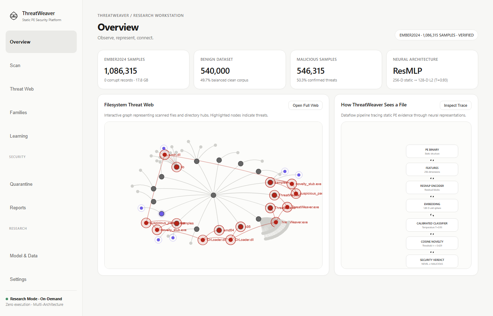
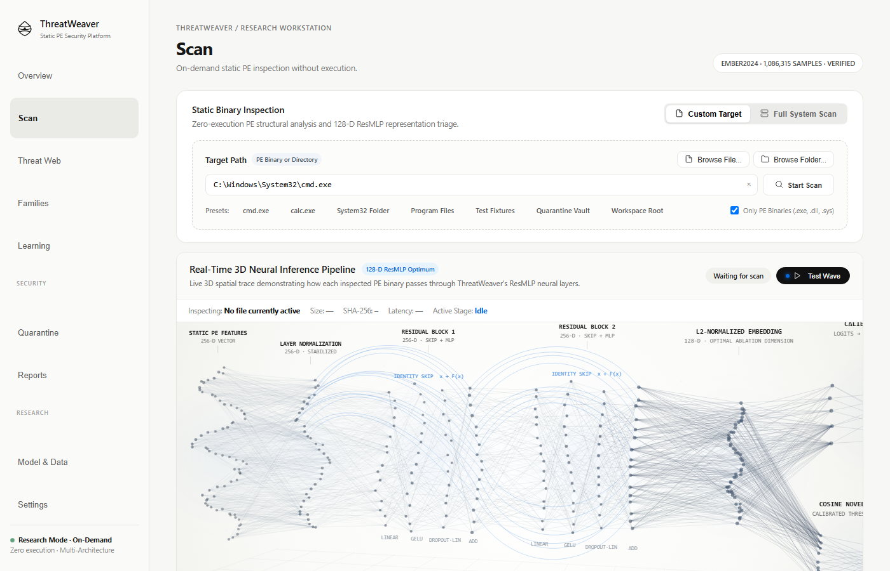
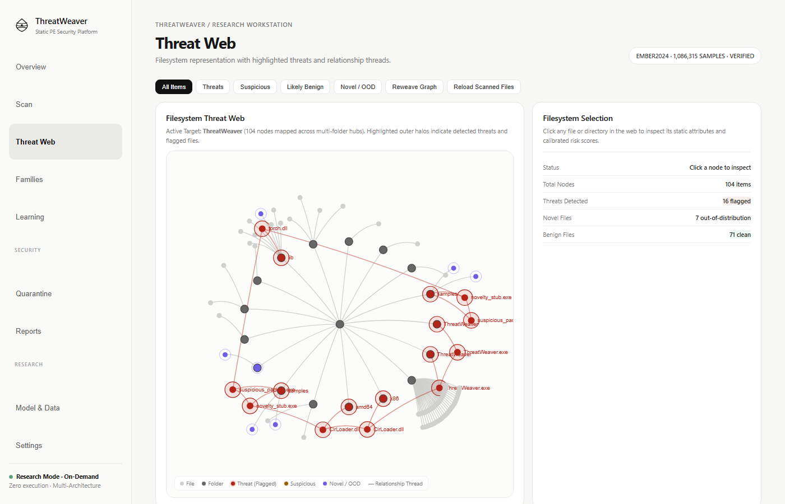
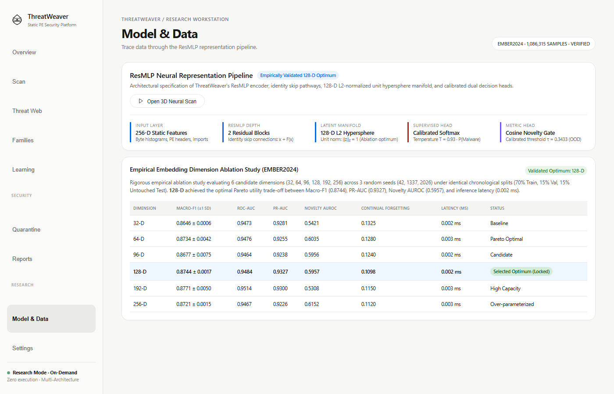

# ThreatWeaver

[](LICENSE)
[](https://www.python.org/)
[](https://github.com/Asmodeus14/ThreatWeaver)
[](SECURITY.md)

**Research prototype for static, zero-execution Windows PE triage.**

ThreatWeaver inspects Portable Executable files as data (it never runs them), scores them with a small neural model, flags files that look unlike its training data, and lets you quarantine and restore files. It is a **research prototype, not an antivirus replacement**: it has no real-time protection, and its current detection quality is modest (see the measured results below). An improvement roadmap is tracked in [`ROADMAP_PROGRESS.md`](ROADMAP_PROGRESS.md).

---

## Feature Status

| Capability | Status | Notes |
| :--- | :--- | :--- |
| Zero-execution static PE parsing (`pefile`) | Implemented | Files are read as bytes; never executed, loaded or emulated |
| 256-D static feature vector | Implemented — **known issues** | Import buckets use Python `hash()`, which varies per process; training features differ from scan-time features (fix: roadmap 2.1–2.2) |
| Neural classifier | Implemented | Shipped checkpoint is a plain MLP (256 → 256 → 128 → 128-D L2 embedding; 0 residual blocks), temperature-scaled (T = 1.11) |
| Cosine novelty ("Unfamiliar") gate | Implemented — **weak** | Novelty AUROC 0.60 on the locked test split |
| Authenticode / catalog verification | Implemented | Currently a full ML bypass for signed files (fix: roadmap 1.6) |
| Hash cache, quarantine/restore, CLI, local UI, desktop wrapper | Implemented | Quarantine uses XOR masking (0x5A), not encryption |
| Continual learning (4 replay strategies) | Experimental | Benchmarked on EMBER2024 .NET windows; in-app adaptation currently replays synthetic seed data |
| Real-time protection / minifilter driver | Planned (design docs only) | See `docs/minifilter_architecture.md` |

---

## User Interface & Visual Showcase

### 1. Main Dashboard & System Overview
Dataset and model facts read from local manifests and the loaded checkpoint, model temperature calibration, live cache hit-rates, and system threat status in an Apple-inspired minimalist aesthetic.



### 2. Static Scanning & Threat Triage Engine
On-demand multi-threaded static inspection with Authenticode verification, neural model verdicts, section entropy profiling, and explainable evidence points.



### 3. Threat Web (Filesystem Cluster Space)
Interactive graph of scanned files grouped by directory, coloured by their real scan verdicts.



### 4. Neural Architecture & Data Flow Studio
Illustrative animation of the pipeline (not live model activations): the 256-D feature extraction, MLP encoder, 128-D L2 projection, temperature scaling, and cosine novelty gating.



---

## Measured Results (v0.1.0)

All values below come from files in `artifacts/`. Nothing here is a target or an estimate.

**Locked test split, shipped 128-D model** (`artifacts/benchmarks/selected_embedding_dimension.json`)

| Metric | Value |
| :--- | :---: |
| Macro-F1 | 0.868 |
| ROC-AUC | 0.937 |
| PR-AUC | 0.933 |
| Detection rate at 1% FPR | 0.180 |
| FPR at 95% recall | 0.329 |
| Expected Calibration Error | 0.046 |
| Novelty AUROC | 0.601 |
| Evasive "challenge" malware flagged as unfamiliar | 22.2% |

**Simple baselines on the same features** (`artifacts/benchmarks/baseline_results.json`): HistGradientBoosting macro-F1 0.915, detection at 1% FPR 0.547; RandomForest macro-F1 0.906.

**Important caveats**

- The test split has only **750 samples spanning about 30 hours**, drawn from EMBER2024 *test* partitions (Win64 + .NET). The official EMBER2024 train partitions were not used. Treat these numbers as indicative, not as operational performance.
- **System32 false positives:** signed Windows binaries are currently accepted by the Authenticode tier without running the model. With that tier disabled, the model scored 38 of 200 System32 `.exe` files (19%) at P(malware) ≥ 0.5 and labelled 65 (32.5%) "Unfamiliar" (measured 2026-11-21). The earlier "0% System32 FPR" figure reflected the signature bypass, not the model.
- Cold scan latency measured at about **135 ms per file** on the System32 sample above (single process, includes parsing).

---

## Installation & Setup

### Prerequisites
- Windows 10/11 x64 (or Linux/macOS for CLI and development)
- Python 3.10 to 3.12 (Tested on Python 3.12.4)
- Git

### Quick Setup

```powershell
# Clone the repository
git clone https://github.com/Asmodeus14/ThreatWeaver.git
cd ThreatWeaver

# Create virtual environment
python -m venv .venv
.\.venv\Scripts\activate

# Install dependencies in editable mode
pip install -e .
```

---

## Usage Instructions

### 1. Launching the Web UI & Dashboard

Start the local-first web interface with live inspection tools:

```powershell
# Launch on default port (http://127.0.0.1:8765)
threatweaver ui

# Or specify custom host/port and disable automatic browser launch
threatweaver ui --host 127.0.0.1 --port 9000 --no-browser
```

### 2. Standalone Windows Desktop App

ThreatWeaver includes a pre-packaged standalone Windows distribution:

```powershell
# Run using the batch launcher
.\ThreatWeaver.bat

# Or run the compiled binary directly
.\dist\ThreatWeaver\ThreatWeaver.exe
```

### 3. Command-Line Interface (CLI)

#### On-Demand File & Directory Scanning
Scan any directory or file with static PE extraction and export formatted reports:

```powershell
# Scan a directory and export reports
threatweaver scan samples/ --export-json reports/scan.json --export-md reports/scan.md

# Scan with custom novelty threshold and calibrated confidence
threatweaver scan C:\Windows\System32 --confidence-threshold 0.85
```

#### Safe Reversible Quarantine
Safely isolate suspicious binaries into the XOR-encrypted vault:

```powershell
# Dry-run validation (checks permissions and path policies without moving)
threatweaver quarantine suspicious_sample.exe --dry-run

# Isolate file into vault
threatweaver quarantine suspicious_sample.exe

# List quarantined items
threatweaver list-quarantine

# Restore file from vault
threatweaver restore <quarantine_id>
```

#### Model & Checkpoint Integrity Verification
Verify the Ed25519 signature of a checkpoint (unsigned or tampered checkpoints are refused at load time):

```powershell
threatweaver verify-checkpoint --path artifacts/checkpoints/threatweaver_v1.pt
```

---

## Architecture Overview

```text
ThreatWeaver/
├── assets/                   # Visual assets, app icons, and UI screenshots
│   ├── threatweaver.ico
│   └── screenshots/
├── configs/                  # Model architectures, data split schemas, replay budgets
│   ├── data.yaml
│   ├── model.yaml
│   └── experiments.yaml
├── docs/                     # Research reports, threat models, kernel driver architecture
│   ├── research_results.md
│   ├── realtime_threat_model.md
│   ├── minifilter_architecture.md
│   └── data_integrity.md
├── samples/                  # Safe synthetic PE binaries for validation
│   ├── benign_utility.exe
│   ├── benign_helper.dll
│   ├── suspicious_packed.exe
│   └── novelty_stub.exe
├── src/threatweaver/
│   ├── app/                  # UI server, Apple minimalist UI, CLI entrypoints, desktop runner
│   │   ├── cli.py
│   │   ├── desktop.py
│   │   ├── server.py
│   │   └── ui_html.py
│   ├── data/                 # Temporal splitters, EMBER loader, normalization scalers
│   ├── learning/             # Uncertainty+Diversity replay buffer, adaptation service
│   ├── models/               # ResMLP encoder, classifier head, temperature scaling, novelty gate
│   ├── quarantine/           # Reversible XOR isolation vault, atomic move, audit logging
│   ├── reporting/            # Scan session history, JSON/Markdown export
│   └── scanner/              # PE parser, 256-D extractor, Authenticode verifier, hash cache
└── tests/                    # Automated unit and integration tests
```

---

## Defensive Security Guarantees

ThreatWeaver adheres to strict defense-in-depth principles:
- **Zero Untrusted Execution:** File evaluation parses PE headers and byte distributions statically. Code is never loaded or executed.
- **Ed25519 Model Integrity:** Shipped checkpoints are signed with an offline release key (public key in `src/threatweaver/models/trusted_keys/`); locally adapted models are signed with a per-install key protected by Windows DPAPI. Unsigned, tampered or unknown-key checkpoints are refused at load time.
- **Pickle Deserialization Protection:** Deserialization enforces `weights_only=True` to eliminate arbitrary code execution gadgets.
- **Critical System Guardrails:** Quarantine operations strictly prohibit isolation of core Windows system files (`ntoskrnl.exe`, `explorer.exe`, `csrss.exe`, etc.).
- **Symlink / TOCTOU Hardening:** Intended, but the current symlink check runs after path resolution and is ineffective (fix: roadmap 1.4).

For full details, see [SECURITY.md](SECURITY.md).

---

## Test Suite

Run the automated test suite:

```powershell
pytest tests/ -v
```

---

## License

ThreatWeaver is licensed under the [Apache License, Version 2.0](LICENSE).  
Copyright 2026 Abhay Singh and ThreatWeaver Contributors.
