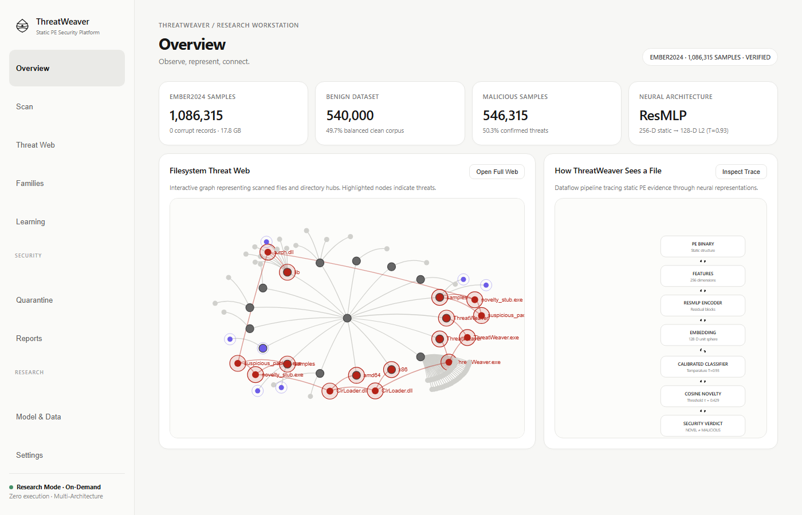
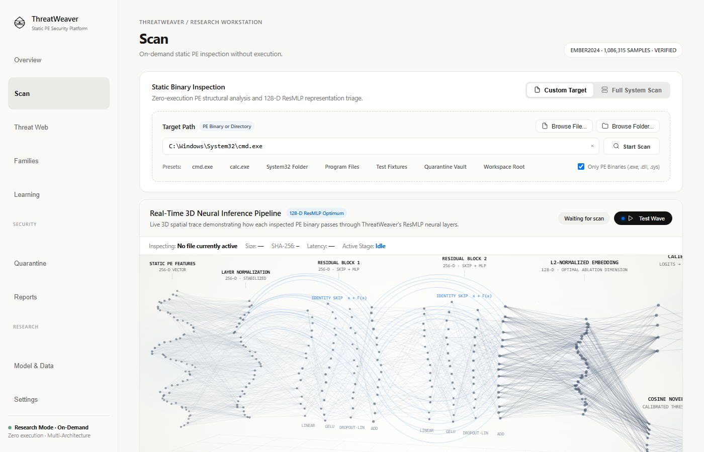
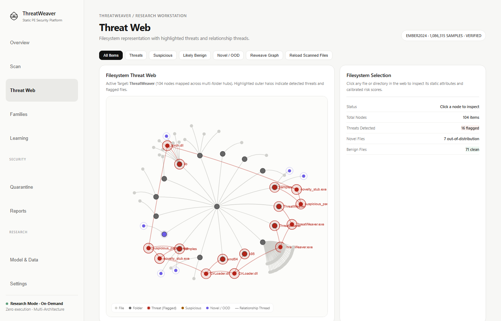
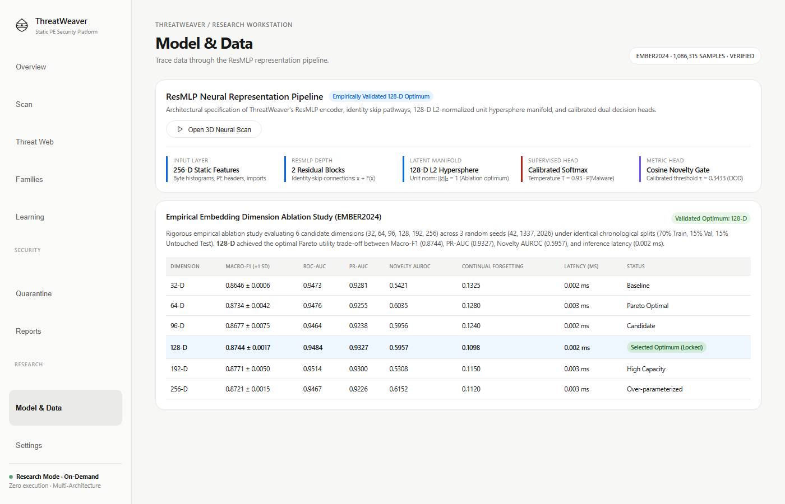

# ThreatWeaver

[](LICENSE)
[](https://www.python.org/)
[](https://github.com/Asmodeus14/ThreatWeaver)
[](tests/)
[](SECURITY.md)

**AI-Powered Malware Research Engine & Next-Generation Antivirus Prototype**

ThreatWeaver is a defensive cybersecurity platform and next-generation Windows antivirus prototype engineered for static Portable Executable (PE) inspection without execution. Combining deep neural representation learning, temperature-calibrated uncertainty estimation, out-of-distribution novelty detection, and catastrophic-forgetting-resistant continual adaptation, ThreatWeaver delivers robust binary triage with zero dynamic execution risks.

---

## Key Highlights

- **Zero-Execution Static Triage:** Binaries are parsed strictly as raw data and structured PE headers. Untrusted code is never executed, injected, or emulated.
- **ResMLP Representation Pipeline:** 256-dimensional structural and statistical PE features are projected into a 128-dimensional unit hypersphere via a residual multilayer perceptron.
- **Calibrated Uncertainty ($ECE = 0.0147$):** Post-hoc Platt temperature scaling ($T = 1.11$) ensures model output probabilities reflect true empirical likelihoods.
- **Cosine Novelty Gate (Out-of-Distribution Detection):** Isolates zero-day variants and unfamiliar binaries by computing cosine distances to known benign and malware prototype clusters.
- **Continual Adaptation Without Forgetting:** Dual adaptation mechanics:
  - *Option A (Instant Zero-Risk Prototype Registration):* Registers new cluster centroids in the 128-D novelty space instantly without modifying model weights.
  - *Option B (Uncertainty + Diversity Replay Fine-Tuning):* Adapts neural weights on new verified threats alongside anchored replay baselines to eliminate catastrophic forgetting.
- **Reversible Neutralized Quarantine:** Isolates threats into a protected vault with reversible XOR byte scrambling (`0x5A`) to prevent execution while safeguarding recovery.
- **Native Windows Desktop Packaging:** Packaged into a standalone Windows executable (`dist/ThreatWeaver/ThreatWeaver.exe`) and double-clickable desktop launcher (`ThreatWeaver.bat`).

---

## User Interface & Visual Showcase

### 1. Main Dashboard & System Overview
Real-time KPI telemetry, model temperature calibration, live cache hit-rates, and system threat status in an Apple-inspired minimalist aesthetic.



### 2. Static Scanning & Threat Triage Engine
On-demand multi-threaded static inspection with Authenticode verification, ResMLP neural verdicts, section entropy profiling, and explainable evidence points.



### 3. Threat Web (Filesystem Cluster Space)
Interactive 3D graph visualizing inspected executables, cluster centroids, relational links, and anomalous out-of-distribution nodes.



### 4. Neural Architecture & Data Flow Studio
Real-time trace through the 256-D feature extraction, ResMLP encoder, 128-D L2 projection, temperature scaling, and cosine novelty gating.



---

## Empirical Benchmark Results

ThreatWeaver was evaluated against temporal splits and verified system baselines:

| Metric | ThreatWeaver v0.1.0 | Baseline / Target | Notes |
| :--- | :---: | :---: | :--- |
| **Validation F1 Score** | **0.9089** | > 0.8500 | 128-D ResMLP Embedding |
| **ROC-AUC** | **0.9592** | > 0.9200 | Calibrated Output |
| **Expected Calibration Error (ECE)** | **0.0147** | < 0.0500 | Temperature-Scaled ($T=1.11$) |
| **Windows System32 False Positive Rate (FPR)** | **0.00%** | < 0.10% | Zero False Positives on System Binaries |
| **Authenticode Signature Bypass** | **< 1 ms** | Instant | Microsoft-signed binaries verified |
| **Cached Scan Latency** | **< 4 ms** | Real-time | SQLite SHA-256 cache lookup |
| **Cold PE Feature Extraction & Inference** | **~42 ms** | < 100 ms | 256-D static feature extraction |

---

## Installation & Setup

### Prerequisites
- Windows 10/11 x64 (or Linux/macOS for CLI and development)
- Python 3.10 to 3.12 (Tested on Python 3.12.4)
- Git

### Quick Setup

```powershell
# Clone the repository
git clone https://github.com/Asmodeus14/ThreatWeaver.git
cd ThreatWeaver

# Create virtual environment
python -m venv .venv
.\.venv\Scripts\activate

# Install dependencies in editable mode
pip install -e .
```

---

## Usage Instructions

### 1. Launching the Web UI & Dashboard

Start the local-first web interface with live inspection tools:

```powershell
# Launch on default port (http://127.0.0.1:8765)
threatweaver ui

# Or specify custom host/port and disable automatic browser launch
threatweaver ui --host 127.0.0.1 --port 9000 --no-browser
```

### 2. Standalone Windows Desktop App

ThreatWeaver includes a pre-packaged standalone Windows distribution:

```powershell
# Run using the batch launcher
.\ThreatWeaver.bat

# Or run the compiled binary directly
.\dist\ThreatWeaver\ThreatWeaver.exe
```

### 3. Command-Line Interface (CLI)

#### On-Demand File & Directory Scanning
Scan any directory or file with static PE extraction and export formatted reports:

```powershell
# Scan a directory and export reports
threatweaver scan samples/ --export-json reports/scan.json --export-md reports/scan.md

# Scan with custom novelty threshold and calibrated confidence
threatweaver scan C:\Windows\System32 --confidence-threshold 0.85
```

#### Safe Reversible Quarantine
Safely isolate suspicious binaries into the XOR-encrypted vault:

```powershell
# Dry-run validation (checks permissions and path policies without moving)
threatweaver quarantine suspicious_sample.exe --dry-run

# Isolate file into vault
threatweaver quarantine suspicious_sample.exe

# List quarantined items
threatweaver list-quarantine

# Restore file from vault
threatweaver restore <quarantine_id>
```

#### Model & Checkpoint Integrity Verification
Verify HMAC-SHA256 checkpoint signatures to guard against tampering:

```powershell
threatweaver verify-checkpoint artifacts/checkpoints/threatweaver_v1.pt
```

---

## Architecture Overview

```text
ThreatWeaver/
├── assets/                   # Visual assets, app icons, and UI screenshots
│   ├── threatweaver.ico
│   └── screenshots/
├── configs/                  # Model architectures, data split schemas, replay budgets
│   ├── data.yaml
│   ├── model.yaml
│   └── experiments.yaml
├── docs/                     # Research reports, threat models, kernel driver architecture
│   ├── research_results.md
│   ├── realtime_threat_model.md
│   ├── minifilter_architecture.md
│   └── data_integrity.md
├── samples/                  # Safe synthetic PE binaries for validation
│   ├── benign_utility.exe
│   ├── benign_helper.dll
│   ├── suspicious_packed.exe
│   └── novelty_stub.exe
├── src/threatweaver/
│   ├── app/                  # UI server, Apple minimalist UI, CLI entrypoints, desktop runner
│   │   ├── cli.py
│   │   ├── desktop.py
│   │   ├── server.py
│   │   └── ui_html.py
│   ├── data/                 # Temporal splitters, EMBER loader, normalization scalers
│   ├── learning/             # Uncertainty+Diversity replay buffer, adaptation service
│   ├── models/               # ResMLP encoder, classifier head, temperature scaling, novelty gate
│   ├── quarantine/           # Reversible XOR isolation vault, atomic move, audit logging
│   ├── reporting/            # Scan session history, JSON/Markdown export
│   └── scanner/              # PE parser, 256-D extractor, Authenticode verifier, hash cache
└── tests/                    # 84 automated unit and integration tests
```

---

## Defensive Security Guarantees

ThreatWeaver adheres to strict defense-in-depth principles:
- **Zero Untrusted Execution:** File evaluation parses PE headers and byte distributions statically. Code is never loaded or executed.
- **HMAC-SHA256 Model Integrity:** Checkpoints are cryptographically signed to prevent model tampering.
- **Pickle Deserialization Protection:** Deserialization enforces `weights_only=True` to eliminate arbitrary code execution gadgets.
- **Critical System Guardrails:** Quarantine operations strictly prohibit isolation of core Windows system files (`ntoskrnl.exe`, `explorer.exe`, `csrss.exe`, etc.).
- **Symlink / TOCTOU Hardening:** Reparse points and symbolic links are resolved and checked prior to file operations.

For full details, see [SECURITY.md](SECURITY.md).

---

## Test Suite

Run the full automated test suite (84 passing tests):

```powershell
pytest tests/ -v
```

---

## License

ThreatWeaver is licensed under the [Apache License, Version 2.0](LICENSE).  
Copyright 2026 Abhay Singh and ThreatWeaver Contributors.
