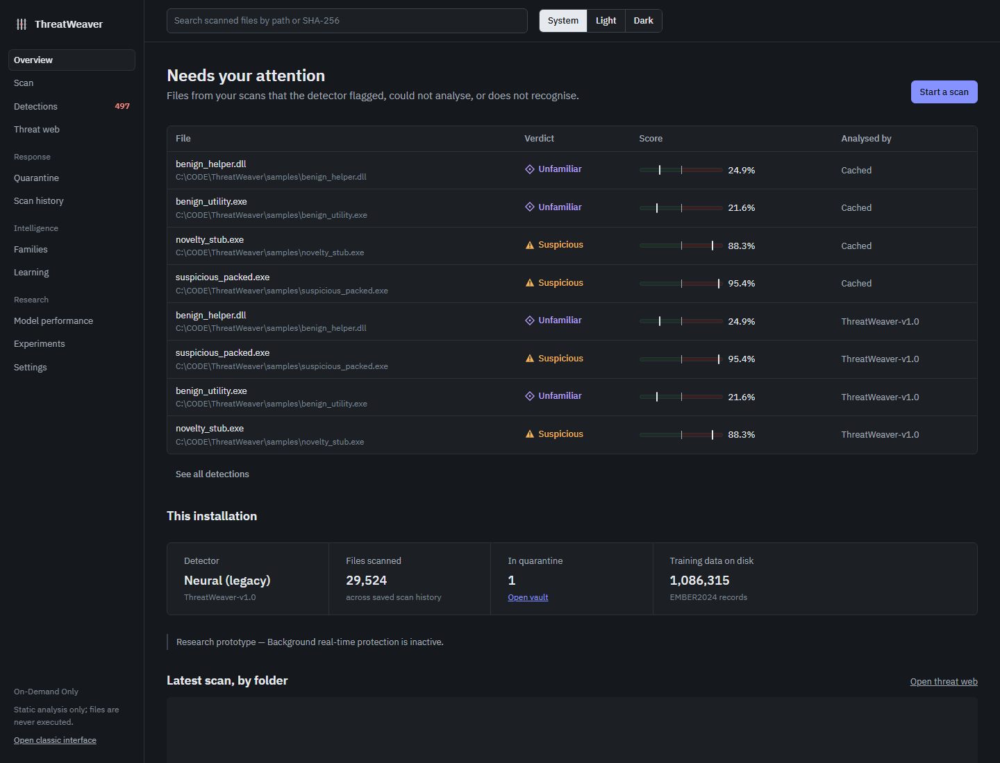
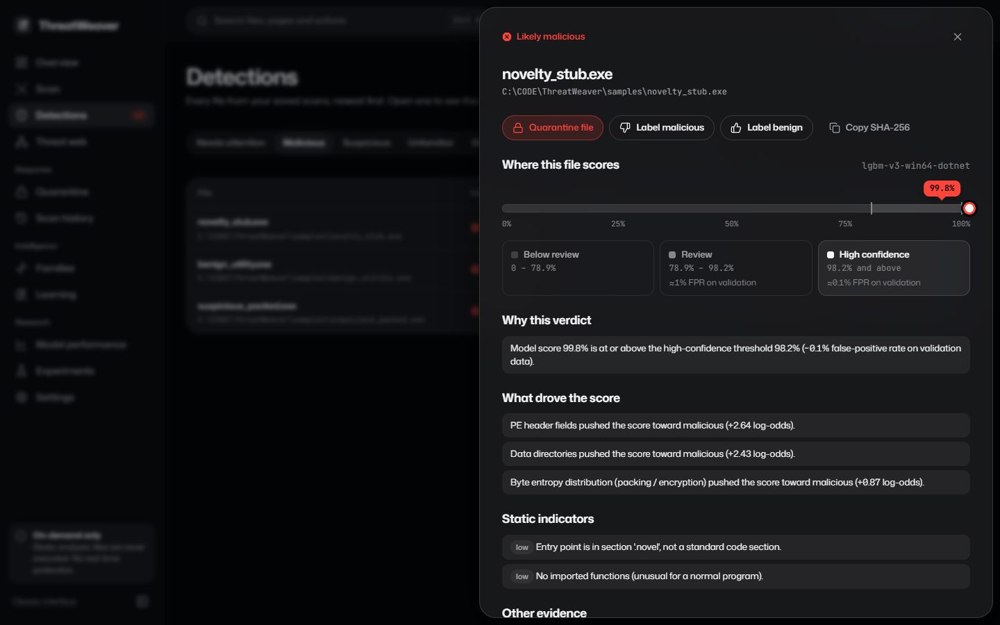
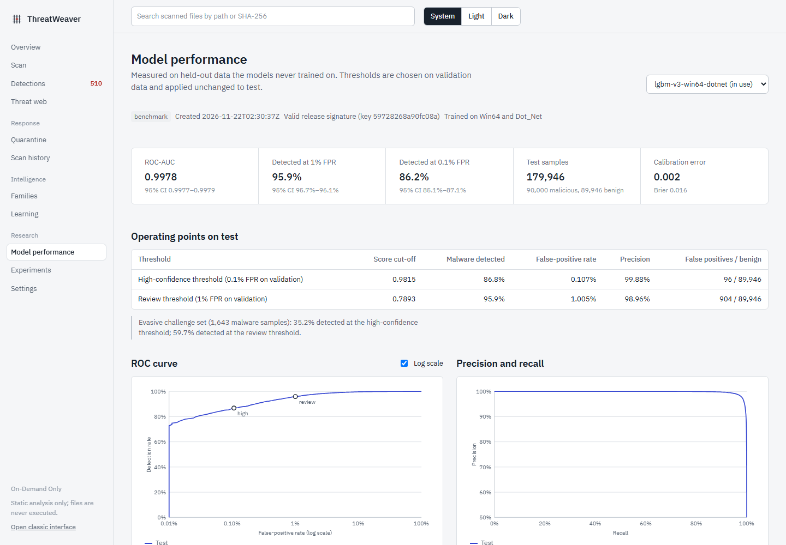
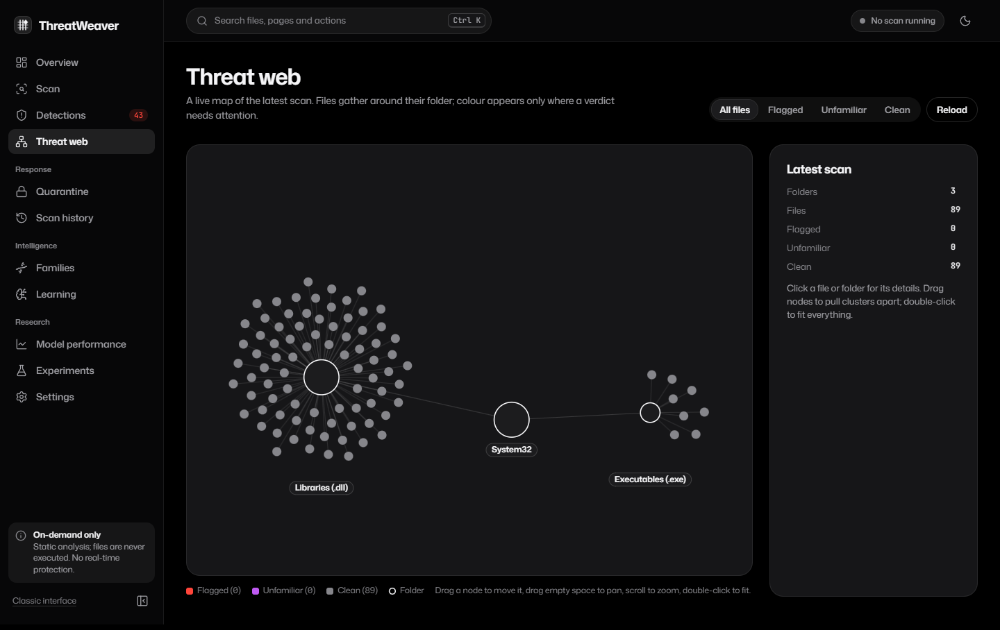

# ThreatWeaver

[](LICENSE)
[](https://www.python.org/)
[](https://github.com/Asmodeus14/ThreatWeaver)
[](SECURITY.md)

**Research prototype for static, zero-execution Windows PE triage.**

ThreatWeaver inspects Portable Executable files as data (it never runs them), scores them with a calibrated LightGBM detector on the official EMBER2024 features, explains each score, and lets you quarantine and restore files. It is a **research prototype, not an antivirus replacement**: it has no real-time protection. Every number below comes from an evaluation artifact in `artifacts/`. Progress is tracked in [`ROADMAP_PROGRESS.md`](ROADMAP_PROGRESS.md).

---

## Feature Status

| Capability | Status | Notes |
| :--- | :--- | :--- |
| Zero-execution static parsing in isolated workers | Implemented | Per-file timeout and memory cap; crashes and hangs become *Analysis Error* |
| LightGBM detector on EMBER2024 v3 features (2,568-D, official `thrember` extractor) | Implemented (default) | Trained on Win64 + .NET; needs the `ember` extra, otherwise the legacy model is used |
| Calibrated thresholds (1% and 0.1% FPR on temporal validation) | Implemented | Drawn on the UI's verdict scale |
| Per-file explanations (exact TreeSHAP) and static indicators | Implemented | Attributions explain the model, not the file's behaviour |
| Known-bad tier: hash lists, allowlist, YARA | Implemented | No third-party rules bundled |
| Authenticode / catalog verification | Implemented | Shown as evidence; the model always runs (the bypass remains only in `--legacy` mode) |
| Legacy v0.1 neural model | Implemented (opt-in, `--legacy`) | Plain MLP on 256-D features; weak (see results) |
| Novelty ("Unfamiliar") detection | Experimental | Separates evasive malware from benign (AUROC 0.79) but not unseen families (0.59); not used in v2 verdicts |
| Observational folder watcher | Experimental | Alerts only; never blocks |
| Opt-in MalwareBazaar hash lookups | Experimental | Off by default; hash only |
| Gated retraining with analyst feedback | Experimental | Regression gate must pass |
| Real-time protection / minifilter driver | Planned (design docs only) | See `docs/minifilter_architecture.md` |

---

## Interface

The interface opens on what needs attention. Each file's score is drawn against the detector's real thresholds, with the evidence behind it.









---

## Measured Results

### v0.2 LightGBM detector (Win64 + .NET), official EMBER2024 test split

Source: `artifacts/models/lgbm-v3-win64-dotnet/eval.json`. 179,946 unique test files (90,000 malicious, 89,946 benign; 119,993 Win64 and 59,953 .NET), all later in time than the training data. Thresholds are chosen on a temporal validation split and applied unchanged.

| Metric | All test files (95% CI) | Win64 | .NET |
| :--- | :---: | :---: | :---: |
| ROC-AUC | 0.9978 (0.9977–0.9979) | 0.9981 | 0.9971 |
| Detection at 1% FPR | 95.9% (95.7–96.1%) | 96.8% | 93.8% |
| Detection at 0.1% FPR | 86.2% (85.1–87.1%) | 88.6% | 81.5% |
| Review threshold: detection / realised FPR | 95.9% / 1.01% | 95.9% / 0.69% | 96.0% / 1.64% |
| High-confidence threshold: detection / realised FPR | 86.8% / 0.11% | 88.3% / 0.09% | 83.8% / 0.15% |
| Evasive challenge set caught at review threshold | 59.7% of 1,643 | 39.8% of 814 | 79.3% of 829 |

**Signed Windows software, model only (signature checks off):** none of 400 System32 `.exe`/`.dll` files and none of 400 randomly chosen Program Files binaries were flagged *Suspicious* or worse (measured 2026-11-22). The previous .NET-only model flagged 16% of System32 programs as *Suspicious*.

**Compared with the .NET-only model on the same files:** on Win64, detection at 1% FPR rose from 57.4% to 96.8%, and at 0.1% FPR from 35.3% to 88.6%. On .NET it fell slightly, from 95.5% to 93.8% at 1% FPR and from 83.5% to 81.5% at 0.1% FPR.

**Limitations**

- Evasive Win64 malware (the EMBER2024 challenge set) is mostly missed: 39.8% is caught at the review threshold and 6.9% at the high-confidence threshold.
- On .NET files the thresholds produce more false positives than their targets (1.64% and 0.15% instead of 1% and 0.1%), because they are tuned on Win64 and .NET together.
- Splits were capped to fit in 15 GB of RAM: 300,000 training and 120,000 validation samples out of 961,589 unique Win64 + .NET samples.
- The bundled `samples/` files are 1–2 KB synthetic stubs, not real programs. The detector scores three of them as *Likely Malicious*, including the one named `benign_utility.exe`; files this unusual are far from anything in the training data.
- Scan time is dominated by parsing in isolated workers: median 266 ms per file, 95th percentile 1.75 s (on the System32 sample above). The model itself takes 0.08 ms per file.

### v0.1.0 legacy model (for comparison)

All values below come from files in `artifacts/`. Nothing here is a target or an estimate.

**Locked test split, shipped 128-D model** (`artifacts/benchmarks/selected_embedding_dimension.json`)

| Metric | Value |
| :--- | :---: |
| Macro-F1 | 0.868 |
| ROC-AUC | 0.937 |
| PR-AUC | 0.933 |
| Detection rate at 1% FPR | 0.180 |
| FPR at 95% recall | 0.329 |
| Expected Calibration Error | 0.046 |
| Novelty AUROC | 0.601 |
| Evasive "challenge" malware flagged as unfamiliar | 22.2% |

**Simple baselines on the same features** (`artifacts/benchmarks/baseline_results.json`): HistGradientBoosting macro-F1 0.915, detection at 1% FPR 0.547; RandomForest macro-F1 0.906.

**Important caveats**

- The test split has only **750 samples spanning about 30 hours**, drawn from EMBER2024 *test* partitions (Win64 + .NET). The official EMBER2024 train partitions were not used. Treat these numbers as indicative, not as operational performance.
- **System32 false positives:** in `--legacy` mode, signed Windows binaries are accepted by the Authenticode tier without running the model. With that tier disabled, the model scored 38 of 200 System32 `.exe` files (19%) at P(malware) ≥ 0.5 and labelled 65 (32.5%) "Unfamiliar" (measured 2026-11-21). The earlier "0% System32 FPR" figure reflected the signature bypass, not the model.
- Cold scan latency measured at about **135 ms per file** on the System32 sample above (single process, includes parsing).

---

## Installation & Setup

### Prerequisites
- Windows 10/11 x64 (Linux/macOS work for the CLI and development; signature checks are Windows-only)
- Python 3.10–3.12 (tested on 3.12.4)
- Node.js 20 only if you want to rebuild the interface (the built UI is included)

### Quick Setup

```powershell
git clone https://github.com/Asmodeus14/ThreatWeaver.git
cd ThreatWeaver
python -m venv .venv
.\.venv\Scripts\activate

# Core install (CPU build of PyTorch)
pip install --extra-index-url https://download.pytorch.org/whl/cpu -e ".[dev]"

# LightGBM detector (EMBER2024 v3 features; without it the legacy model is used) and optional YARA rules
pip install -e ".[ember,rules]"

# Exact, tested environment
pip install --extra-index-url https://download.pytorch.org/whl/cpu -r requirements.lock.txt
```

---

## Usage

### Interface

```powershell
threatweaver ui                    # http://127.0.0.1:8765, LightGBM detector
threatweaver ui --legacy           # use the v0.1 neural model instead
threatweaver ui --print-token      # print the API token for scripts
```

The interface opens on what needs attention. Open any file to see its verdict, the calibrated score against the detector's real thresholds, what drove the score, static indicators, and actions (quarantine, label for learning). The classic v0.1 interface remains available at `/legacy`.

The API requires the per-session token (sent automatically by the UI). Scripts send it as the `X-ThreatWeaver-Token` header; the OpenAPI schema is at `/api/openapi.json`.

### Command line

```powershell
threatweaver scan C:\Users\you\Downloads --export-md scan.md
threatweaver quarantine suspicious_sample.exe --dry-run
threatweaver quarantine suspicious_sample.exe
threatweaver list-quarantine
threatweaver restore <quarantine_id>
threatweaver verify-checkpoint --path artifacts/checkpoints/threatweaver_v1.pt
```

### Known-bad rules, hash lists and threat intel (optional)

Put files under `%LOCALAPPDATA%\ThreatWeaver\rules\`:
- `hashes\*.txt`: one SHA-256 per line, optional `# label`
- `allowlist\*.txt`: hashes you have reviewed and trust
- `yara\**\*.yar`: your YARA rules (none are bundled)

A match makes the verdict *Known Malicious* and names the rule. MalwareBazaar hash lookups can be enabled in Settings with your own API key; only SHA-256 values are sent.

### Watching a folder

Settings, *Watch a folder*, scans executables as they appear or change (for example in Downloads). It only observes and alerts; it never blocks, moves or deletes files, and it is not real-time protection.

### Where data is stored

The quarantine vault, scan history, cache, local model versions, keys and rules live in `%LOCALAPPDATA%\ThreatWeaver` (override with `THREATWEAVER_HOME`).

### Research workflow

```powershell
python tools/download_ember2024.py --target Win64_train             # SHA-256 verified; also Dot_Net_train
python tools/build_ember_v3_dataset.py --file-types Win64 Dot_Net
python tools/train_lgbm.py --data-dir data/ember_v3 --name lgbm-v3
python tools/train_lgbm.py ... --feedback labels.json --gate-against artifacts/models/lgbm-v3/eval.json
python tools/reproduce_v01_eval.py                                  # continuity check of the v0.1 numbers
```

See [docs/architecture.md](docs/architecture.md) for the pipeline and component map.

---

## Security

- Files are parsed as data in isolated worker processes with time and memory limits; nothing is executed.
- The local API is protected against cross-site requests and DNS rebinding.
- Models are Ed25519-signed and refused if unsigned or tampered; LightGBM loads from text, PyTorch with `weights_only=True`.
- Quarantine rejects symlinks and junctions, protects Windows system folders by exact path, signs its manifest and verifies every restore.

Details and the threat model: [SECURITY.md](SECURITY.md).

---

## Tests

```powershell
pytest -q                       # Python (unit, integration, security, fuzzing)
cd frontend; npm test           # interface logic
```

---

## License

ThreatWeaver is licensed under the [Apache License, Version 2.0](LICENSE).  
Copyright 2026 Abhay Singh and ThreatWeaver Contributors.
